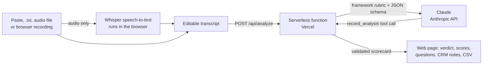

# Discovery Call Analyser v2

An AI coach for SDRs and outbound sales teams. **Role-play a discovery call or chat with an AI buyer**, or add a conversation of your own, and it:

- **Scores how well the lead was qualified** with **MEDDICC**, **BANT** or **SPICED**, quoting the conversation as evidence for every score
- **Flags what wasn't asked** and gives the exact questions to ask on the next call
- **Shows what to say better**: quotes the rep's weak lines and the buyer cues they missed, gives the exact words to use instead, and names the one thing to fix first
- **Recommends a verdict** (Advance, Nurture or Disqualify) and next steps
- **Highlights the transcript**, tagging each quote with the element it supports
- **Drafts the follow-up email** to the buyer, ready to copy or open in your email app
- **Writes CRM notes**, ready to copy or export with your history as CSV
- **Saves a PDF report** of the scorecard, transcript, email and CRM notes
- **Tracks progress**: average score over time, the elements you miss most often, and the selling skills that come up most in coaching

Conversations can come from a **role-play with an AI buyer**, or be **pasted**, uploaded as a **.txt** file, uploaded as an **audio recording**, or **recorded in the browser**. Audio is transcribed on the user's own device, so recordings are never uploaded.

Version 1, built for my Business Analyst with Applied AI course, is at [discovery-call-analyser](https://github.com/Juliet6364/Discovery-call-analyser). This is a clean rebuild with audio input, three frameworks and a new design.

## What changed from v1

| Area | v1 | v2 |
|---|---|---|
| Input | Paste or .txt | Paste, .txt, audio file, or record in the browser |
| Frameworks | MEDDICC | MEDDICC, BANT, SPICED |
| AI output | JSON parsed from free text | Forced tool call with a JSON schema, then validated |
| Demo mode | Saved MEDDICC results for 5 calls | Saved results for 6 conversations in all 3 frameworks |
| Practice | None | Role-play calls and chats with four AI buyers, live hints, and a reveal of what the buyer knew |
| Outputs | Scorecard, CRM notes | Adds "Say it better" line-by-line coaching, highlighted transcript, follow-up email draft and PDF report |
| Progress | History table | History plus a dashboard: score trend and most-missed elements |
| Tests | None | Automated tests for validation, scoring bands and the API |

## How it works



1. **Audio** is decoded in the browser, split at quiet moments into one-minute parts, and transcribed by Whisper (`whisper-base.en`) running on the device with Transformers.js. The first run downloads about 80 MB of model files, which the browser then keeps. Whisper doesn't identify speakers, so the prompt tells Claude to work out who is the rep and who is the buyer, and the user can add names before analysing.
2. **The server** adds the chosen framework's rubric and forces Claude to answer through a `record_analysis` tool whose schema fixes the number of elements, the 0–2 score range and the three verdicts.
3. **Validation** (`validate()` in `api/analyze.js`) checks every field again before anything reaches the page, so a malformed response can't break it.

## Role-play with an AI buyer

Reps practise on the page instead of on real prospects:

1. **Pick a buyer, a channel and a difficulty.** Four fictional buyers, each with a different challenge: an open but busy finance head, a guarded CIO, a price-sceptical founder, and a tough VP who is already evaluating two vendors. Choose **Call** (talk into the microphone or type, and the buyer can answer out loud) or **Chat** (typed, WhatsApp style), and **Friendly**, **Realistic** or **Tough**. Reps can enter their own name and what they sell.
2. **Run the conversation.** Each buyer has private facts (pain, numbers, budget, who signs off, decision process, paperwork, timeline, competition, a possible champion and objections). They only share a fact when the rep asks a question that earns it, push back on early pitching, and only agree to a next meeting if the rep has earned it.
3. **Press Hint when stuck.** A separate coach reads the conversation so far (without seeing the buyer's private facts) and suggests the exact next line, tagged with the framework element it targets.
4. **End and score.** The conversation goes straight into the analyser and opens on **Say it better**. The page then shows **What the buyer knew**, so the rep can see which facts they never uncovered.

How it's built: `api/roleplay.js` keeps the buyer personas on the server (`public/personas.js`), so the page can't change how a buyer behaves, and the rep's "what you sell" text is passed to the model as data, not instructions. Replies use a faster model (`CLAUDE_ROLEPLAY_MODEL`, default `claude-haiku-5-5`) so the conversation feels live. In call mode the rep's speech is turned into text on the device with the same Whisper model used for uploads, and the buyer's voice uses the browser's built-in speech synthesis.

## Scoring

Each element is scored **0** (not covered), **1** (partly covered) or **2** (clearly established).

| Framework | Elements | Max | Best for |
|---|---|---|---|
| MEDDICC | Metrics, Economic buyer, Decision criteria, Decision process, Paper process, Identify pain, Champion, Competition | 16 | Enterprise deals with several approvers |
| BANT | Budget, Authority, Need, Timeline | 8 | Quick first-call checks |
| SPICED | Situation, Pain, Impact, Critical event, Decision | 10 | Value-led SaaS discovery |

Score bands use the share of the maximum so all three read the same way: under 40% weakly qualified, 40–74% needs work, 75% and above well qualified. For MEDDICC that is 0–6, 7–11 and 12–16, the same as v1.

**The score and the verdict measure different things.** The score shows how well the rep qualified the lead. The verdict shows whether the deal is worth pursuing. A well-run call can score high and still end in Disqualify.

## Say it better

Scores tell a rep *what* was missed; this tab shows *how* to fix it. For each conversation the AI picks the 3 to 5 moments that mattered most:

| Type | What it quotes | What it gives |
|---|---|---|
| Could be said better | A line the rep said: pitching too early, a closed question, price without value, accepting "send me a proposal" | The line to say instead |
| Missed cue | A line the buyer said that wasn't followed up: a number, a name, a competitor, a hint about timing | The follow-up question to ask |

Each moment is tagged with one of six selling skills (Opening, Discovery questions, Listening and follow-up, Value and pricing, Objection handling, Next step), and the result opens with **Fix this first**, the one change that would most improve the next conversation. Chat suggestions are written in chat style, short and informal. Moments are highlighted in blue on the transcript, coaching notes can be copied for a 1:1, and the dashboard counts which skill comes up most across all conversations.

## Practice conversations

Six role-plays for a fictional automation vendor, Nexora Automation. All companies and people are fictional.

| Buyer | Designed as | MEDDICC | BANT | SPICED | Verdict |
|---|---|---|---|---|---|
| CIO, auto components | Strong call | 15/16 | 8/8 | 9/10 | Advance |
| COO, logistics | Average call | 7/16 | 4/8 | 8/10 | Nurture |
| IT head, hospital chain | Mixed call | 9/16 | 6/8 | 8/10 | Nurture |
| IT director, NBFC | Weak call | 1/16 | 1/8 | 3/10 | Disqualify |
| CEO, D2C startup | Good call, poor fit | 10/16 | 7/8 | 8/10 | Disqualify |
| Finance controller, retail | WhatsApp chat | 9/16 | 4/8 | 8/10 | Nurture |

SPICED scores the average calls higher than MEDDICC because it doesn't ask about paperwork, champions or competitors. That difference is useful: it shows which framework a team's reps are actually following.

## Responsible use

- Role-play buyers and their companies are fictional. Role-play messages are sent to the AI only to play the buyer and give hints, and aren't stored.
- Use role-played calls, or calls where everyone has agreed to be recorded and reviewed. The page says so next to the Analyse button.
- Audio never leaves the device. Transcripts are sent to the AI only when the user clicks Analyse.
- No database: history is kept in the browser's local storage.
- The API key lives only in Vercel's environment settings.
- Every score has a quote, so a person can check it. The tool advises; a manager decides.

## Limitations

- Speech-to-text doesn't label speakers and can mishear names and numbers. Check the transcript before analysing.
- The first transcription needs a download of about 80 MB and works best in a recent desktop Chrome or Edge. Long recordings are slow on older phones. Recordings over 45 minutes are refused.
- AI scores can vary slightly between runs.
- History is per browser and doesn't sync between devices.
- In voice role-play the rep presses the microphone to talk and again to send, so it feels like a walkie-talkie rather than a phone call. Each turn takes a few seconds to transcribe.
- The AI buyer can occasionally reveal more than it should or drift from its facts; the "What the buyer knew" panel is the reference.

## Set up

1. Deploy this repository to Vercel (no build step; static files are in `public/`, the function in `api/`).
2. In the Vercel project, add the environment variable `ANTHROPIC_API_KEY`. Optionally set `CLAUDE_MODEL` (default `claude-sonnet-5-5`) for analysis and `CLAUDE_ROLEPLAY_MODEL` (default `claude-haiku-5-5`) for the AI buyer and hints.
3. Without a key the site still works: practice conversations show saved results, and transcription works, but live analysis and role-play show a message.

Run the tests with `npm test` (Node 18 or later, no dependencies).

## Files

```
api/analyze.js            Prompt, Claude API call, schema and validation
api/roleplay.js           AI buyer replies and live hints
public/index.html         The web app
public/frameworks.js      MEDDICC, BANT and SPICED definitions, shared by page and API
public/personas.js        AI buyers and their private facts, shared by page and API
public/samples.js         Practice conversations and saved results
public/transcribe-worker.js  In-browser speech-to-text
sample-transcripts/       The practice conversations as .txt files
test/                     Automated tests for both API functions
```

Built by [Juliet Arambam](https://www.linkedin.com/in/juliet-arambam1).
